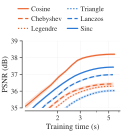
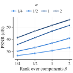
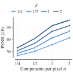
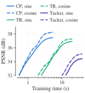
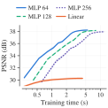
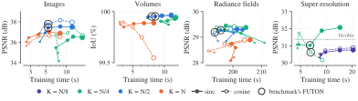

# Ablations

FUTON's design choices, varied one at a time: the basis, the number of components against the rank, the combiner and the decoder on the image task (the 24 Kodak images at 768 × 512, 1000 steps, each on the whole image), and the number of components against the decoder's width on all four tasks. Unless stated, the default model is the benchmark's FUTON (sinc): K = (H/2, W/2) components per axis, 384 × 256 for a landscape image, CP rank 280 and a one-layer MLP decoder 64 wide, 197,379 parameters, trained at 3e-2; the studies after the first repeat each comparison with the cosine basis at its rate, 1e-1. The configs are in `configs/ablation-futon/`, and every table and plot here is in `results/ablation/`. The runs are compiled and timed as the benchmark's, on A100s, and every time is the median over the signals.

## Basis

All six families at the default size. The number of parameters does not depend on the basis, so the columns are what each family costs and what it buys.

| Basis | Orthogonal | Support | Smoothness | Training time (s) ↓ | PSNR (dB) ↑ |
| --- | --- | --- | --- | --- | --- |
| Cosine | yes | global | $C^\infty$ | 5.6 | **38.20** ± 0.06 |
| Chebyshev | weighted | global | $C^\infty$ | **5.4** | 36.43 ± 0.09 |
| Legendre | yes | global | $C^\infty$ | **5.4** | 36.30 ± 0.06 |
| Triangle | no | compact | $C^0$ | 5.6 | 36.03 ± 0.07 |
| Lanczos | no | compact | $C^1$ | **5.4** | 36.98 ± 0.05 |
| Sinc | no | global | $C^\infty$ | **5.4** | _37.43_ ± 0.05 |

<figure markdown="span">
  { width="520" }
  <figcaption>PSNR against training time for every basis.</figcaption>
</figure>

The two benchmark bases lead: cosine at 38.2 dB and sinc 0.8 dB behind it, then Lanczos at 37.0 dB and the triangle and the two polynomial families at 36.0 to 36.4. Training time hardly varies, 5.4 to 5.6 s: every basis is tabulated on the pixel grid (`grid_size = (H, W)`), so a step reads rows of the same tables whatever the family, and the compact support of the triangle and Lanczos saves nothing there. The orthogonal cosine is the best of the global families by 1.8 dB, and the smooth Lanczos kernel beats the triangle's $C^0$ kink by a decibel.

## Components against rank

The two sizes of a FUTON, the number of components per axis and the CP rank, scaled with the image: K = (αH, αW) and R = β min(K), for α and β in {1/8, 1/4, 1/2, 1, 2}, 25 models per basis (`components_rank.yaml`). The sinc basis is shown; the cosine results are in `results/ablation/`. Because K and R both set the size, the grid spans 2,051 to 5,374,211 parameters, from a hundredth of the benchmark's budget to 27 times it, and its lower right holds more parameters than the image has values:

| α \ β | 1/8 | 1/4 | 1/2 | 1 | 2 |
| --- | --- | --- | --- | --- | --- |
| 1/8 | 2.1k | 3.8k | 7.4k | 14.6k | 28.9k |
| 1/4 | 6.4k | 12.5k | 24.8k | 49.4k | 98.6k |
| 1/2 | 22.8k | 45.3k | 90.4k | 180k | 361k |
| 1 | 86.3k | 172k | 344k | 688k | 1.38M |
| 2 | 336k | 672k | 1.34M | 2.69M | 5.37M |

Parameters per cell, $(h + w + 64) R + 259$ for $K = (h, w)$; the benchmark's model sits in the third row just past β = 1, at R = 280.

<figure markdown="span">
  { width="520" }
  { width="520" }
  <figcaption>PSNR against the rank factor β, one curve per component factor α; and the same runs against α, one curve per β. The 1/8 level of either is left to the table: its models are too small to matter and only compress the axis.</figcaption>
</figure>

Mean PSNR (dB) over the 24 images for the sinc basis:

| α \ β | 1/8 | 1/4 | 1/2 | 1 | 2 |
| --- | --- | --- | --- | --- | --- |
| 1/8 | 23.03 | 24.39 | 25.70 | 27.01 | 28.55 |
| 1/4 | 25.03 | 26.74 | 28.55 | 30.74 | 33.24 |
| 1/2 | 27.75 | 30.27 | 33.27 | 36.88 | 40.88 |
| 1 | 31.44 | 35.77 | 41.29 | 46.68 | 51.34 |
| 2 | 35.83 | 41.36 | 46.73 | 51.42 | **55.94** |

Rank is the lever that keeps paying: at every α, each doubling of β raises the PSNR, by about 1.4 dB on the coarsest grid and by 4.5 to 5.5 dB on the finest, up to the lower right, whose models hold more parameters than the image has values and reach 55.9 dB, short of the 58.9 dB of the 8-bit quantization step. Components saturate at the sampling resolution. The cells (α, β) and (2α, β/2) share a rank, and along such a chain doubling K is worth 2 to 6 dB up to K = (H, W), more at higher ranks, and nothing beyond it: from one to two components per pixel the gain is under 0.1 dB, for nearly twice the parameters. That is why the benchmark spends its budget on R at K = (H/2, W/2): near 180k parameters the cell (1/2, 1) reaches 36.9 dB where (1, 1/4) stays at 35.8 for 172k and (2, 1/8) at 35.8 for 336k, and the benchmark's R = 280 lands at 37.4 dB just past β = 1. Training time grows with the rank, from 1.5 s at the smallest cells to 31 s at the largest. The cosine grid is within 1.2 dB of every sinc cell, ahead at the larger ranks for α up to 1/2, except the two largest models, at α = 2, where it trails by 2.6 and 9.5 dB.

## Combiner

Tensor-ring and Tucker combiners against the CP one, at the default K, for both bases, each at the largest rank that keeps FUTON smaller than every baseline. A ring of rank $r$ feeds the decoder $r^2$ features and grows with them: rank 16 holds 180,483 parameters, and rank 17 would hold 203,715. Tucker takes a rank per axis in proportion to its components, $R_c = \gamma K_c$ with $\gamma = 0.163$: on a 512 × 768 image it projects the axes to 41 and 62 directions and contracts them with a $41 \times 62 \times 62$ core whose 62 features feed the decoder, 196,135 parameters. The cosine basis trains the ring at its rate, 1e-1, and Tucker at 3e-2, since at 1e-1 Tucker diverges on 8 of the 24 images.

| Combiner | #Params (k) | FUTON (sinc) Training time (s) ↓ | FUTON (sinc) PSNR (dB) ↑ | FUTON (cosine) Training time (s) ↓ | FUTON (cosine) PSNR (dB) ↑ |
| --- | --- | --- | --- | --- | --- |
| CP | 197.4 | **5.4** | **37.44** ± 0.03 | **5.6** | **38.21** ± 0.11 |
| TR | 180.5 | _20.2_ | _36.89_ ± 0.06 | _20.1_ | _37.25_ ± 0.08 |
| Tucker | 196.1 | 39.8 | 34.41 ± 0.12 | 40.0 | 35.10 ± 0.10 |

<figure markdown="span">
  { width="520" }
</figure>

CP wins on both counts: by 0.55 dB (sinc) and 0.96 dB (cosine) and 3.7 times the training time over the ring, whose $r \times r$ matrices per point cost more to contract than CP's $R$ products and whose 256 features the decoder then has to close; and by 3.0 and 3.1 dB and 7.4 times over Tucker, whose core holds 157,604 of its parameters while each axis passes through only 41 or 62 directions against CP's 280.

## Decoder

The paper's model has a linear decoder, which makes FUTON exactly a rank-$R$ CP model of the signal; the benchmarks use a one-layer MLP 64 wide. Wider MLPs and the linear decoder are compared at equal size, each at the largest rank, a multiple of 5, that keeps FUTON smaller than every baseline: 255 behind a hidden layer of 128 units, 220 behind 256, and 305 for the linear map, which frees the MLP's 18k parameters.

| Decoder | #Params (k) | FUTON (sinc) Training time (s) ↓ | FUTON (sinc) PSNR (dB) ↑ | FUTON (cosine) Training time (s) ↓ | FUTON (cosine) PSNR (dB) ↑ |
| --- | --- | --- | --- | --- | --- |
| MLP, 64 wide (R = 280) | 197.4 | _5.4_ | 37.43 ± 0.09 | _5.4_ | **38.21** ± 0.06 |
| MLP, 128 wide (R = 255) | 196.4 | 8.3 | **37.54** ± 0.09 | 8.1 | _38.15_ ± 0.07 |
| MLP, 256 wide (R = 220) | 198.1 | 12.1 | _37.50_ ± 0.10 | 12.1 | 37.94 ± 0.07 |
| Linear (R = 305) | 196.1 | **4.3** | 30.45 ± 0.20 | **4.3** | 30.26 ± 0.19 |

<figure markdown="span">
  { width="520" }
  <figcaption>PSNR against training time for every decoder, for both bases.</figcaption>
</figure>

Beyond 64 units the width buys at most 0.1 dB, with the sinc basis at 128, for 1.5 times the training time, and the cosine basis is best at 64; below 64 the decoder loses, 0.5 dB at 32 units and 1.4 dB at 16 (see the components against the width, below). A natural image is far from a low-rank tensor in a smooth basis: at equal size the linear model stops at 30.5 dB, 7 dB below the MLP, though it trains fastest. The MLP decoder 64 wide is therefore the default on every task, and the linear decoder remains the model to reason about, the one the [error bound](../concepts/error-bound.md) covers.

## Components against width, on every task

The benchmarks size FUTON by one rule: $K = N/2$ components per axis, never more than the data observes, a decoder of one hidden layer 64 wide, and the largest rank, a multiple of 5, that keeps it smaller than every baseline. This study tests the rule on all four tasks: $K = N/L$ for $L$ in {4, 2, 1}, with $N$ the resolution along each axis, against decoders 16, 32, 64, 128 and 256 wide, each at the largest rank within the task's budget, for both bases at their benchmark learning rates, 30 models per task (`components_width_<task>.yaml`). Each task keeps its benchmark protocol and signals, except super-resolution, which runs on the three DIV2K training images its settings were tuned on and adds $L = 8$: there $N$ is the high-resolution grid, so $N/4$ is the low-resolution image the model sees. The benchmark's FUTON is one point of each study, $N/2$ and 64 units ($N/4$ in super-resolution).

<figure markdown="span">
  { width="960" }
  <figcaption>Mean quality against median training time for every configuration, a curve per number of components through the five widths, the marker growing with the width, sinc solid and cosine dashed; the ring marks the benchmark's FUTON. The radiance fields' times lie within 10 % of each other, on a linear axis; super-resolution leaves out the two finer grids, which end far below bicubic.</figcaption>
</figure>

**Images and volumes.** $K = N/2$ is best at every width, for both bases. At 64 units the sinc basis reaches 37.43 dB on images at $N/2$ against 36.20 at $N/4$ and 36.78 at $N$, and 99.95 % IoU on volumes against 99.91 and 99.88. The budget explains the order: a rank costs a factor entry per component and a weight per hidden unit, 384 parameters on a 768 × 512 image at $N/4$, 704 at $N/2$ and 1,344 at $N$, so the 64-wide decoder fits ranks 515, 280 and 145. Halving the components from $N/2$ nearly doubles the rank but leaves the basis coarser than the image's detail; doubling them halves the rank. Beyond 64 units the decoder adds at most 0.1 dB on images and 0.02 points of IoU on volumes, for 1.2 to 2.2 times the training time; below 64 it costs images 0.5 dB at 32 units and 1.4 dB at 16 (sinc), while volumes keep 99.94 to 99.95 % even at 16. Fewer components cost time and memory, since the rank grows: at 64 units an image trains in 10.4 s at $N/4$, 5.4 s at $N/2$ and 3.9 s at $N$, at a peak of 1,042, 668 and 455 MB.

The cosine cell at $N/2$ and 64 units, 37.78 dB, is low by one image: kodim20 stalls at 28.9 dB here, where four other runs of the identical model, in the benchmark and the basis, combiner and decoder studies, reach 37.4 to 39.3 dB. On the other 23 images the cell and the benchmark's run agree, at 38.17 dB on average, and against those runs of the 64-wide model, 38.14 to 38.21 dB over all 24 images, the wider cosine decoders gain at most 0.02 dB. The cosine basis also degrades on volumes at $K = N$ as the decoder widens, to 99.55 % at 256 units.

**Radiance fields.** Here $N$ is the 200 pixels of a view's side, and the training time hardly moves, 191 to 211 s, since the ray marching dominates it. $N/4$ and $N/2$ tie at 64 units, at 29.28 dB each with the sinc basis and 29.25 and 29.19 dB with the cosine one. A wider decoder adds 0.1 to 0.2 dB at $N/4$ (29.45 dB at 128 units with sinc), which puts it ahead of $N/2$ at 64 units by about one standard error of the difference, and at most 0.03 dB with sinc and 0.12 dB with cosine at $N/2$; $K = N$ trails by 0.3 to 1.2 dB, and below 64 units the field loses up to 0.1 dB at 32 and 0.3 to 0.4 dB at 16. Memory tells the tied grids apart: it follows the rank, and at 64 units $N/4$, at rank 310, peaks at 8.8 GB against 6.0 GB for $N/2$ at rank 180.

**Super-resolution.** Only the low-resolution grid works. Components finer than it, at $N/2$ and $N$, lie largely in the null space of the downsampling operator: they get almost no gradient through it and keep their random start, which leaves the sinc basis at 24 to 27 dB and the cosine basis at 15 to 17 dB, far below bicubic's 31.37 dB on these images. Coarser components, $N/8$, cost the sinc basis 0.4 to 1.3 dB against $N/4$. The rule's cap makes this choice: half the high-resolution grid is more than the data observes, so the rule takes the observed $N/4$.

The width matters through one image. On 0395 and 0431 every width at $N/4$ beats bicubic, by 0.2 dB and by 0.4 to 1.4 dB. On 0777, which bicubic reproduces at 36.2 dB, most configurations fail, in one of two ways: the fit of the observed pixels stalls 6 to 10 dB short of the others (the sinc basis up to 64 units, the cosine basis at 16), or it succeeds and the high-resolution image carries artifacts (the cosine basis from 64 units on, down to 26.8 dB at 256), as FUTON (cosine) fails on five test images. Only the sinc basis at 128 and 256 units (36.2 and 36.8 dB) and the cosine basis at 32 (36.4 dB) avoid both. The benchmark's 64-wide models are therefore below bicubic on these three images on average, by 0.3 dB with sinc and 0.8 dB with cosine, where on the 100 test images FUTON (sinc) beats it on 95 (see [Benchmarks](benchmarks.md#super-resolution)); a wider decoder would help the sinc basis here and hurt the cosine one.

**The rule.** One number of components serves every task: $N/2$ is best on images and volumes at every width, ties $N/4$ on radiance fields at 64 units with a third less memory, and in super-resolution the cap, never more than the data observes, turns it into the low-resolution grid, the one level that works there. A decoder 64 wide is the narrowest within 0.1 dB of the best on images, within 0.12 dB of the wider ones on radiance fields at $N/2$, and wider than volumes need; in super-resolution the width decides only how 0777 fails. One width for every task is therefore 64.

??? note "Every configuration, per task"

    === "Images"

        | Components, decoder | #Params (k) | Training memory (MB) ↓ | FUTON (sinc) Training time (s) ↓ | FUTON (sinc) PSNR (dB) ↑ | FUTON (cosine) Training time (s) ↓ | FUTON (cosine) PSNR (dB) ↑ |
        | --- | --- | --- | --- | --- | --- | --- |
        | N/4, 16 wide | 198.3 | 1010 | 7.7 | 34.16 ± 0.13 | 7.6 | 34.95 ± 0.18 |
        | N/4, 32 wide | 197.3 | 1013 | 7.0 | 35.48 ± 0.11 | 7.0 | 36.73 ± 0.13 |
        | N/4, 64 wide | 198.0 | 1042 | 10.4 | 36.20 ± 0.10 | 10.4 | 36.90 ± 0.17 |
        | N/4, 128 wide | 197.6 | 1124 | 12.5 | 36.56 ± 0.11 | 12.5 | 37.47 ± 0.13 |
        | N/4, 256 wide | 196.9 | 1493 | 17.0 | 36.46 ± 0.11 | 17.0 | 36.64 ± 0.17 |
        | N/2, 16 wide | 196.9 | 549 | 4.1 | 36.06 ± 0.09 | 4.1 | 36.92 ± 0.10 |
        | N/2, 32 wide | 198.4 | 591 | 4.9 | 36.93 ± 0.06 | 4.9 | 37.80 ± 0.08 |
        | N/2, 64 wide | 197.4 | 668 | 5.4 | 37.43 ± 0.03 | 5.4 | 37.78 ± 0.39 |
        | N/2, 128 wide | 196.4 | 1024 | 8.1 | **37.54** ± 0.03 | 8.1 | **38.16** ± 0.07 |
        | N/2, 256 wide | 198.1 | 1176 | 12.1 | _37.51_ ± 0.05 | 12.1 | _37.97_ ± 0.08 |
        | N, 16 wide | 194.5 | **313** | **2.6** | 36.02 ± 0.12 | **2.6** | 35.64 ± 0.15 |
        | N, 32 wide | 196.9 | _363_ | _2.8_ | 36.46 ± 0.12 | _2.8_ | 35.93 ± 0.21 |
        | N, 64 wide | 195.1 | 455 | 3.9 | 36.78 ± 0.11 | 3.9 | 36.57 ± 0.14 |
        | N, 128 wide | 197.6 | 661 | 5.6 | 37.04 ± 0.11 | 5.6 | 36.65 ± 0.17 |
        | N, 256 wide | 193.0 | 1027 | 8.1 | 36.89 ± 0.10 | 8.1 | 36.56 ± 0.13 |

    === "Volumes"

        | Components, decoder | #Params (k) | Training memory (MB) ↓ | FUTON (sinc) Training time (s) ↓ | FUTON (sinc) IoU (%) ↑ | FUTON (cosine) Training time (s) ↓ | FUTON (cosine) IoU (%) ↑ |
        | --- | --- | --- | --- | --- | --- | --- |
        | N/4, 16 wide | 131.3 | 1049 | 11.1 | 99.87 ± 0.04 | 10.9 | 99.87 ± 0.04 |
        | N/4, 32 wide | 131.2 | 954 | 9.2 | 99.91 ± 0.04 | 9.4 | 99.90 ± 0.04 |
        | N/4, 64 wide | 130.8 | 830 | 10.7 | 99.91 ± 0.03 | 10.8 | 99.91 ± 0.03 |
        | N/4, 128 wide | 130.6 | 729 | 12.6 | 99.93 ± 0.02 | 12.6 | 99.94 ± 0.02 |
        | N/4, 256 wide | 130.1 | 648 | 12.8 | 99.94 ± 0.02 | 12.8 | 99.94 ± 0.02 |
        | N/2, 16 wide | 131.1 | 564 | 6.9 | 99.95 ± 0.02 | 7.0 | 99.94 ± 0.02 |
        | N/2, 32 wide | 130.7 | 550 | 7.1 | 99.95 ± 0.01 | 6.9 | 99.94 ± 0.01 |
        | N/2, 64 wide | 130.6 | 531 | 8.2 | 99.95 ± 0.01 | 7.6 | 99.95 ± 0.01 |
        | N/2, 128 wide | 130.4 | 883 | 9.5 | **99.96** ± 0.01 | 9.5 | _99.96_ ± 0.01 |
        | N/2, 256 wide | 130.3 | 578 | 11.6 | **99.96** ± 0.01 | 11.6 | **99.97** ± 0.01 |
        | N, 16 wide | 131.1 | **306** | **3.8** | 99.88 ± 0.03 | **3.8** | 99.90 ± 0.02 |
        | N, 32 wide | 130.1 | _312_ | _4.1_ | 99.85 ± 0.04 | _4.1_ | 99.90 ± 0.02 |
        | N, 64 wide | 129.8 | 331 | 5.1 | 99.88 ± 0.04 | 5.1 | 99.84 ± 0.02 |
        | N, 128 wide | 129.0 | 388 | 6.4 | 99.89 ± 0.02 | 6.1 | 99.75 ± 0.05 |
        | N, 256 wide | 129.3 | 651 | 7.9 | 99.89 ± 0.02 | 7.9 | 99.55 ± 0.19 |

    === "Radiance fields"

        | Components, decoder | #Params (k) | Training memory (GB) ↓ | FUTON (sinc) Training time (s) ↓ | FUTON (sinc) PSNR (dB) ↑ | FUTON (cosine) Training time (s) ↓ | FUTON (cosine) PSNR (dB) ↑ |
        | --- | --- | --- | --- | --- | --- | --- |
        | N/4, 16 wide | 73.9 | 11.49 | 211.1 | 28.78 ± 0.19 | 207.6 | 28.78 ± 0.18 |
        | N/4, 32 wide | 74.3 | 10.51 | 202.8 | 29.16 ± 0.14 | 202.9 | 29.16 ± 0.17 |
        | N/4, 64 wide | 73.8 | 8.81 | _197.1_ | 29.28 ± 0.12 | 195.1 | 29.25 ± 0.14 |
        | N/4, 128 wide | 73.9 | 6.83 | 197.5 | **29.45** ± 0.12 | 194.2 | _29.37_ ± 0.12 |
        | N/4, 256 wide | 73.7 | _4.97_ | 204.6 | _29.38_ ± 0.09 | 200.5 | **29.41** ± 0.11 |
        | N/2, 16 wide | 73.1 | 6.74 | 197.6 | 28.84 ± 0.12 | 194.7 | 28.85 ± 0.08 |
        | N/2, 32 wide | 73.4 | 6.52 | 200.3 | 29.17 ± 0.05 | _193.3_ | 29.16 ± 0.08 |
        | N/2, 64 wide | 73.0 | 5.96 | **195.7** | 29.28 ± 0.06 | 193.6 | 29.19 ± 0.11 |
        | N/2, 128 wide | 72.8 | 5.16 | 203.4 | 29.29 ± 0.06 | 201.5 | 29.31 ± 0.06 |
        | N/2, 256 wide | 71.9 | **4.85** | 201.4 | 29.31 ± 0.09 | 199.1 | 29.31 ± 0.05 |
        | N, 16 wide | 74.5 | 5.26 | 200.3 | 28.22 ± 0.12 | 193.4 | 28.41 ± 0.11 |
        | N, 32 wide | 73.3 | 5.15 | 199.2 | 28.09 ± 0.28 | **191.4** | 28.46 ± 0.14 |
        | N, 64 wide | 73.9 | 5.00 | 200.9 | 28.59 ± 0.09 | 199.0 | 28.67 ± 0.12 |
        | N, 128 wide | 74.1 | 5.09 | 199.5 | 28.74 ± 0.14 | 197.0 | 28.74 ± 0.12 |
        | N, 256 wide | 70.7 | 5.41 | 206.0 | 28.90 ± 0.14 | 204.0 | 28.89 ± 0.17 |

    === "Super-resolution"

        | Components, decoder | #Params (k) | Training memory (MB) ↓ | FUTON (sinc) Training time (s) ↓ | FUTON (sinc) PSNR (dB) ↑ | FUTON (cosine) Training time (s) ↓ | FUTON (cosine) PSNR (dB) ↑ |
        | --- | --- | --- | --- | --- | --- | --- |
        | N/8, 16 wide | 499.5 | 1279 | 8.4 | 30.31 ± 0.98 | 8.3 | 30.52 ± 0.56 |
        | N/8, 32 wide | 499.5 | 1278 | 8.7 | 30.47 ± 0.95 | 8.7 | 30.49 ± 0.74 |
        | N/8, 64 wide | 498.0 | 1238 | 9.8 | 30.62 ± 0.95 | 9.7 | 30.74 ± 0.80 |
        | N/8, 128 wide | 497.3 | 1243 | 14.4 | 30.73 ± 0.99 | 14.4 | 30.82 ± 0.90 |
        | N/8, 256 wide | 497.4 | 1329 | 20.7 | 30.75 ± 1.08 | 20.7 | _30.88_ ± 0.87 |
        | N/4, 16 wide | 497.4 | 661 | 4.6 | 31.07 ± 0.76 | 4.6 | 30.85 ± 0.69 |
        | N/4, 32 wide | 497.9 | 683 | 4.8 | 31.07 ± 0.84 | 4.8 | **31.74** ± 1.16 |
        | N/4, 64 wide | 497.8 | 728 | 6.5 | 31.03 ± 0.90 | 6.6 | 30.62 ± 0.67 |
        | N/4, 128 wide | 498.8 | 825 | 8.9 | _31.88_ ± 1.32 | 9.0 | 30.16 ± 0.92 |
        | N/4, 256 wide | 498.3 | 1222 | 14.5 | **32.07** ± 1.52 | 14.4 | 28.43 ± 2.35 |
        | N/2, 16 wide | 497.1 | 355 | 2.8 | 26.11 ± 1.20 | 2.8 | 17.04 ± 0.20 |
        | N/2, 32 wide | 493.2 | 383 | 3.2 | 26.39 ± 1.26 | 3.1 | 17.18 ± 0.36 |
        | N/2, 64 wide | 493.6 | 445 | 4.0 | 26.98 ± 0.85 | 3.9 | 17.05 ± 0.65 |
        | N/2, 128 wide | 493.5 | 568 | 5.9 | 26.57 ± 0.93 | 6.1 | 16.80 ± 0.35 |
        | N/2, 256 wide | 499.3 | 816 | 9.3 | 26.52 ± 0.88 | 8.9 | 16.40 ± 0.10 |
        | N, 16 wide | 494.8 | **200** | **2.6** | 25.04 ± 1.61 | **2.5** | 14.62 ± 1.15 |
        | N, 32 wide | 497.2 | _233_ | **2.6** | 24.72 ± 1.12 | **2.5** | 16.07 ± 0.67 |
        | N, 64 wide | 484.7 | 295 | 2.7 | 24.60 ± 0.93 | 2.9 | 15.58 ± 0.66 |
        | N, 128 wide | 493.9 | 436 | 4.0 | 24.47 ± 0.96 | 4.0 | 15.35 ± 0.96 |
        | N, 256 wide | 494.0 | 689 | 6.6 | 24.07 ± 0.81 | 6.7 | 15.26 ± 0.83 |
