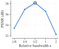
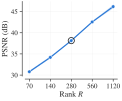

# Ablations

FUTON's design choices, varied one at a time on the image task: the basis, the bandwidth at a fixed size, the rank on either side of that size, the combiner and the decoder. The default model is the benchmark's FUTON (cosine): $K = (H/2, W/2)$ components per axis, 384 × 256 for a landscape image, CP rank 280 and a one-layer MLP decoder 64 wide, 197,379 parameters, trained at 1e-1. Every study keeps the benchmark's protocol, the 24 Kodak images at 768 × 512, 1000 steps, each on the whole image, compiled and timed as the benchmark's on A100s, so only the model changes; and every model but the rank study's takes the largest rank, a multiple of 5, that keeps FUTON smaller than every baseline (F-INR (SIREN), 198,806 parameters). Every model trains at the default's rate, 1e-1, but for three exceptions that each section names: the five families beside the cosine take the sinc basis's rate, 3e-2; two models of the sweeps take 3e-2 because it wins on kodim01 and kodim17, as the benchmark picks its rates; and the Tucker combiner takes 3e-2 because 1e-1 diverges. The configs are in `configs/ablation-futon/`; the tables are `results/ablation/<study>.md` as `scripts/report_paper.py` writes them, with the benchmark's columns: every cost is the median over the images, bold marks the best value in a column and italics the second, and ± is one within-image standard error.

- **Basis.** The cosine basis leads at 38.2 dB, the sinc basis follows at 37.4 dB, and all six families cost the same to train.
- **Bandwidth.** At a fixed size, half the image's resolution per axis is best: halving or doubling it costs 1.2 to 1.6 dB.
- **Rank.** From a quarter to four times the benchmark's rank, every doubling adds 3.4 to 4.4 dB.
- **Combiner.** CP beats tensor-ring and Tucker combiners of about its size by 1.0 and 3.1 dB, and trains 3.6 and 7.1 times faster.
- **Decoder.** At equal size a wider MLP buys nothing, and a linear decoder costs 8 dB.

The default model appears in every study. The bandwidth and rank studies reuse the benchmark's runs of it, at 38.14 dB; the other three run it again, so that each stands alone, and land at 38.20 to 38.21 dB. The difference is one image: on kodim20 the same model and seed ends anywhere from 37.4 to 39.3 dB from run to run, the benchmark's run lowest, while on the other 23 images every run of it agrees to within 0.16 dB.

## Basis

All six families at the default size, so that the parameter count does not depend on the basis: the columns are what each family costs and what it buys. Three families are orthogonal, global and smooth: the cosine, Legendre's polynomials and Chebyshev's, the last under a weight. The sinc is global and smooth but not orthogonal on the interval, and the triangle ($C^0$) and Lanczos ($C^1$) kernels have compact support. The cosine basis trains at its own rate, 1e-1, and the other five at the sinc basis's, 3e-2, the benchmark's rate for it.

| Basis | #Params (k) | Training time (s) ↓ | Training memory (MB) ↓ | Inference throughput (MPix/s) ↑ | Inference memory (MB) ↓ | PSNR (dB) ↑ | SSIM ↑ | LPIPS ↓ |
| --- | --- | --- | --- | --- | --- | --- | --- | --- |
| Cosine | 197.4 | 5.6 | **668** | 171.6 | **541** | **38.20** ± 0.06 | **0.956** ± 0.001 | **0.096** ± 0.001 |
| Chebyshev | 197.4 | **5.4** | **668** | _172.9_ | **541** | 36.43 ± 0.09 | 0.939 ± 0.001 | 0.125 ± 0.001 |
| Legendre | 197.4 | **5.4** | **668** | 169.0 | 542 | 36.30 ± 0.06 | 0.937 ± 0.001 | 0.129 ± 0.001 |
| Triangle | 197.4 | 5.6 | 669 | 148.9 | **541** | 36.03 ± 0.07 | 0.934 ± 0.001 | 0.127 ± 0.001 |
| Lanczos | 197.4 | **5.4** | 673 | 156.8 | **541** | 36.98 ± 0.05 | 0.944 ± 0.001 | 0.112 ± 0.001 |
| Sinc | 197.4 | **5.4** | **668** | **174.5** | **541** | _37.43_ ± 0.05 | _0.949_ ± 0.001 | _0.108_ ± 0.001 |

<figure markdown="span">
  { width="360" }
  <figcaption>PSNR against training time for every basis, the band one within-image standard error.</figcaption>
</figure>

The two benchmark bases lead: the cosine at 38.20 dB and the sinc 0.77 dB behind it, then Lanczos at 36.98 dB and Chebyshev, Legendre and the triangle at 36.0 to 36.4. Among the orthogonal families the cosine leads the two polynomial ones by 1.8 dB, and among the kernels Lanczos's smoother lobes beat the triangle's kinks by a decibel. Training costs the same for every family, 5.4 to 5.6 s and 668 to 673 MB: each basis is tabulated on the pixel grid (`grid_size = (H, W)`), so a step reads rows of tables of the same shape whatever the family, and the compact support of the triangle and Lanczos saves nothing there; evaluating the whole image is 9 to 13 % slower with those two. SSIM and LPIPS order the bases as PSNR does, but for the triangle and Legendre, 0.27 dB apart, which LPIPS swaps.

## Bandwidth

The relative bandwidth $\kappa = K / N$, the components per axis as a fraction of the pixels, over {1/8, 1/4, 1/2, 1, 2}, at the budget. A rank costs a factor entry per component on each axis and a weight per hidden unit, $(K_1 + K_2 + 64) R + 259$ parameters in all, so the rank falls as the bandwidth grows: 885, 515, 280, 145 and 75. At $\kappa = 1$ each axis has as many components as pixels, the grid's Nyquist rate, and $\kappa = 1/2$ is the benchmark's FUTON (cosine). The model at $\kappa = 1/8$ trains at 3e-2, since at 1e-1 it loses 1.4 dB on kodim01 and kodim17.

| κ | R | #Params (k) | Training time (s) ↓ | Training memory (GB) ↓ | Inference throughput (MPix/s) ↑ | Inference memory (MB) ↓ | PSNR (dB) ↑ | SSIM ↑ | LPIPS ↓ |
| --- | --- | --- | --- | --- | --- | --- | --- | --- | --- |
| 1/8 | 885 | 198.5 | 16.6 | 1.63 | 73.9 | 1493 | 33.40 ± 0.14 | 0.914 ± 0.003 | 0.167 ± 0.005 |
| 1/4 | 515 | 198.0 | 10.4 | 1.04 | 116.2 | 911 | _36.90_ ± 0.18 | _0.947_ ± 0.003 | _0.120_ ± 0.004 |
| 1/2 | 280 | 197.4 | 5.4 | 0.67 | 175.6 | 541 | **38.14** ± 0.11 | **0.956** ± 0.003 | **0.098** ± 0.003 |
| 1 | 145 | 195.1 | _3.9_ | _0.46_ | **206.6** | _329_ | 36.57 ± 0.13 | 0.936 ± 0.002 | 0.140 ± 0.003 |
| 2 | 75 | 197.1 | **2.7** | **0.36** | _200.5_ | **218** | 32.26 ± 0.18 | 0.860 ± 0.007 | 0.270 ± 0.008 |

<figure markdown="span">
  { width="360" }
  <figcaption>PSNR against the relative bandwidth at the budget, the band one within-image standard error; the ring marks the benchmark's model.</figcaption>
</figure>

Half the resolution is best, at 38.14 dB, and the PSNR falls on either side: by 1.24 dB at $\kappa = 1/4$ and 1.57 dB at $\kappa = 1$, and by 4.7 and 5.9 dB at 1/8 and 2. The budget explains the peak. Below $\kappa = 1/2$ the rank grows but the basis is coarser than the image's detail, which the MLP's nonlinearity only partly makes up: at $\kappa = 1/8$ the cosines alone cap a linear FUTON at 23.65 dB on average, the truncation on the [error bound](../concepts/error-bound.md) page, and the MLP reaches 33.40. Above it the rank shrinks, and past $\kappa = 1$ the extra components add no function the pixel grid can tell apart, so $\kappa = 2$ pays twice the factor entries for the span of $\kappa = 1$. The costs run the other way, since the rank sets them: at $\kappa = 1/8$ FUTON trains 3.1 times slower than at 1/2 and at 2.4 times the memory, and at $\kappa = 2$ in half the time and memory, for 5.9 dB less. SSIM and LPIPS agree with the PSNR's order.

## Rank

The CP rank over {70, 140, 280, 560, 1120} at the benchmark's bandwidth, $\kappa = 1/2$, on either side of the budget: the size doubles with the rank, from 49,539 to 788,739 parameters, a quarter to four times the benchmark's. Rank 1120 trains at 3e-2, since at 1e-1 it loses 4.6 dB on kodim01 and kodim17.

| R | #Params (k) | Training time (s) ↓ | Training memory (GB) ↓ | Inference throughput (MPix/s) ↑ | Inference memory (GB) ↓ | PSNR (dB) ↑ | SSIM ↑ | LPIPS ↓ |
| --- | --- | --- | --- | --- | --- | --- | --- | --- |
| 70 | 49.5 | **2.7** | **0.34** | **227.9** | **0.21** | 30.80 ± 0.24 | 0.826 ± 0.010 | 0.305 ± 0.008 |
| 140 | 98.8 | _3.5_ | _0.45_ | _197.9_ | _0.32_ | 34.18 ± 0.23 | 0.903 ± 0.003 | 0.190 ± 0.004 |
| 280 | 197.4 | 5.4 | 0.67 | 175.6 | 0.54 | 38.14 ± 0.10 | 0.956 ± 0.003 | 0.098 ± 0.003 |
| 560 | 394.5 | 9.6 | 1.11 | 109.4 | 0.98 | _42.56_ ± 0.17 | _0.983_ ± 0.005 | _0.040_ ± 0.004 |
| 1120 | 788.7 | 17.7 | 2.00 | 69.0 | 1.86 | **46.18** ± 0.42 | **0.992** ± 0.005 | **0.017** ± 0.006 |

<figure markdown="span">
  { width="360" }
  <figcaption>PSNR against the CP rank at $\kappa = 1/2$, the band one within-image standard error; the ring marks the benchmark's model.</figcaption>
</figure>

Rank keeps paying. Each doubling adds 3.4 to 4.4 dB, the last, to rank 1120, still 3.6: there FUTON holds 788,739 parameters, two thirds of the image's 1,179,648 values, and reaches 46.18 dB, still 12.7 dB below the 58.9 dB of the images' 8-bit quantization. The costs grow a little slower than the rank: from 280 to 1120, training takes 3.3 times as long at 3.0 times the memory, and evaluation runs 2.5 times slower. Below the benchmark's rank the fixed costs show, and halving the rank saves only a third of the training time. In the benchmark, the budget rather than the model holds FUTON near 38 dB.

## Combiner

Tensor-ring and Tucker combiners against the CP one, at the default $K$, each at the largest rank within the budget. A ring of rank $r$ feeds the decoder $r^2$ features and grows with them: rank 16 holds 180,483 parameters, and rank 17 would hold 203,715. Tucker takes a rank per axis in proportion to its components, $R_c = \gamma K_c$ with $\gamma = 0.163$: on a 512 × 768 image it projects the axes to 41 and 62 directions and contracts them with a $41 \times 62 \times 62$ core whose 62 features feed the decoder, 196,135 parameters. The ring trains at the default's rate, 1e-1, and Tucker at 3e-2, since at 1e-1 it diverges on 8 of the 24 images.

| Combiner | #Params (k) | Training time (s) ↓ | Training memory (GB) ↓ | Inference throughput (MPix/s) ↑ | Inference memory (GB) ↓ | PSNR (dB) ↑ | SSIM ↑ | LPIPS ↓ |
| --- | --- | --- | --- | --- | --- | --- | --- | --- |
| CP | 197.4 | **5.6** | **0.67** | **169.4** | **0.54** | **38.21** ± 0.09 | **0.956** ± 0.002 | **0.096** ± 0.002 |
| TR | 180.5 | _20.1_ | _1.63_ | _51.1_ | _1.21_ | _37.25_ ± 0.07 | _0.947_ ± 0.001 | _0.112_ ± 0.002 |
| Tucker | 196.1 | 40.0 | 8.18 | 34.2 | 4.26 | 35.10 ± 0.13 | 0.915 ± 0.002 | 0.171 ± 0.003 |

<figure markdown="span">
  { width="360" }
  <figcaption>PSNR against training time for every combiner, the band one within-image standard error.</figcaption>
</figure>

CP wins on every count. Against the ring it gains 0.96 dB at 3.6 times less training time and 2.4 times less memory: the ring's $r \times r$ matrices per point cost more to contract than CP's $R$ products, and its 256 features leave the decoder to close it. Against Tucker it gains 3.11 dB at 7.1 times less training time and 12 times less memory: the core holds 157,604 of Tucker's parameters, while each axis passes through only 41 or 62 directions against CP's 280, and contracting it makes evaluation 5 times slower.

## Decoder

With a linear decoder FUTON is exactly a rank-$R$ CP model of the signal's coefficients in its basis, the model the theory treats; the benchmarks use a one-layer MLP 64 wide. Wider MLPs and the linear decoder are compared at equal size, each at the largest rank within the budget: 255 behind a hidden layer of 128 units, 220 behind 256, and 305 for the linear map, which frees the MLP's 18k parameters. All four keep the tanh on the output and the default's rate, 1e-1.

| Decoder | #Params (k) | Training time (s) ↓ | Training memory (MB) ↓ | Inference throughput (MPix/s) ↑ | Inference memory (MB) ↓ | PSNR (dB) ↑ | SSIM ↑ | LPIPS ↓ |
| --- | --- | --- | --- | --- | --- | --- | --- | --- |
| MLP, 64 wide (R = 280) | 197.4 | _5.4_ | _669_ | _164.5_ | _541_ | **38.21** ± 0.07 | **0.956** ± 0.002 | **0.096** ± 0.002 |
| MLP, 128 wide (R = 255) | 196.4 | 8.1 | 1024 | 120.5 | 602 | _38.15_ ± 0.08 | _0.954_ ± 0.002 | _0.100_ ± 0.002 |
| MLP, 256 wide (R = 220) | 198.1 | 12.1 | 1176 | 84.4 | 749 | 37.94 ± 0.07 | 0.951 ± 0.002 | 0.106 ± 0.002 |
| Linear (R = 305) | 196.1 | **4.3** | **515** | **204.7** | **485** | 30.26 ± 0.19 | 0.874 ± 0.006 | 0.201 ± 0.004 |

<figure markdown="span">
  { width="360" }
  <figcaption>PSNR against training time for every decoder, the band one within-image standard error.</figcaption>
</figure>

Width buys nothing at this size: the 128- and 256-wide MLPs give up rank for it and end 0.06 and 0.27 dB below the 64-wide one, in 1.5 and 2.2 times its training time. A natural image is far from a low-rank tensor in a smooth basis: at equal size the linear decoder stops at 30.26 dB, 8 dB below the MLP, though it trains fastest. The MLP decoder 64 wide is therefore the default, and the linear decoder remains the model to reason about: without its bias and tanh, it is the model the [error bound](../concepts/error-bound.md) covers.
