# Benchmarks

Fourteen models on four tasks, at equal parameter count per task; the fourth, super-resolution, adds the deep image prior and three interpolations as references. The tables are `results/<task>/table.md` as `scripts/report_paper.py` writes them from the runs in `logs/`; the figures are the paper's. Bold marks the best value in a column and italics the second; ± is one standard error over the signals, after removing each signal's own level (a paired standard error); IoU, which saturates near 100 % on every shape, takes the plain standard error over the shapes.

Notes on the rows:

- A name in parentheses is the variant a row runs where its kind has several: FUTON's basis, and the backbone of F-INR and FreSh; the configs call the two FUTONs `FUTON-sinc` and `FUTON-cosine`.
- **TensoRF** is the variant its authors recommend for the dimension: CP on images (the only one in 2D) and VM on volumes and radiance fields; both are in the configs.
- **MFN** is the GaborNet of the two networks of its paper, and **WIRE** the real Gabor variant (`nf.RealWIRE`) from the WIRE paper and code.
- **F-INR (SIREN)** gives each coordinate its own SIREN, built and initialized as in its authors' image code, and combines them per channel by a CP decomposition. Their settings do not fit the budget, so we tuned at equal size what they leave open: the split between width and rank (in 2D the most rank a width allows, one more than the width; width 96 and rank 259 on volumes, width 32 and rank 39 on radiance fields), the first layer's frequency (200 on images, above their 100, and 100 elsewhere) and the decomposition, CP rather than the tensor train they pick for shapes and radiance fields. Neither the positional encoding of their image experiments nor the SIREN of their shape code helps at this size. Their paper fits radiance fields with per-axis hash grids; here the axes are SIRENs on every task.
- **FreSh (SIREN)** is the SIREN row with its first-layer frequency chosen per signal before training, by matching the spectrum of the untrained network's output to the signal's, and the search counts toward its training time. Its paper covers images and radiance fields; on volumes it reads the 3D spectrum of the occupancy grid, and on super-resolution that of the low-resolution image, our two adaptations. On super-resolution, where the SIREN row runs every layer at a tuned frequency of 120, FreSh keeps it in the later layers.

Accuracy and costs come from the same runs. Every model is compiled with `torch.compile` and trained on an A100 after an untimed warm-up pass that compiles it. The training time counts the training steps alone; inference throughput and memory are the medians over a run's evaluations, for a radiance field over its 200 test views, and training memory is the run's peak. Each cost in the tables and figures is the median over a task's signals.

## Images

24 Kodak images at 768 × 512, about 197k parameters per model, 1000 steps, each on the whole image, scored on every pixel.

| Model | #Params (k) | Training time (s) ↓ | Training memory (GB) ↓ | Inference throughput (MPix/s) ↑ | Inference memory (GB) ↓ | PSNR (dB) ↑ | SSIM ↑ | LPIPS ↓ |
| --- | --- | --- | --- | --- | --- | --- | --- | --- |
| RFF | 199.7 | 29.8 | 2.08 | 30.7 | 1.21 | 31.28 ± 0.14 | 0.846 ± 0.007 | 0.271 ± 0.007 |
| PE-MLP | 209.2 | 32.8 | 2.11 | 33.2 | 0.81 | 27.86 ± 0.15 | 0.726 ± 0.015 | 0.431 ± 0.008 |
| MFN | 204.3 | 57.3 | 7.67 | 26.8 | 3.22 | 36.72 ± 0.15 | 0.938 ± 0.003 | 0.129 ± 0.003 |
| SIREN | 198.9 | 35.7 | 3.25 | 34.4 | 0.81 | 33.57 ± 0.15 | 0.906 ± 0.003 | 0.192 ± 0.004 |
| FreSh (SIREN) | 198.9 | 39.3 | 3.25 | 34.5 | 0.81 | 34.88 ± 0.14 | 0.922 ± 0.003 | 0.150 ± 0.004 |
| Gauss | 198.9 | 36.6 | 3.64 | 34.3 | 0.81 | 32.33 ± 0.17 | 0.877 ± 0.004 | 0.213 ± 0.004 |
| WIRE | 199.3 | 42.2 | 4.00 | 31.5 | 0.86 | 30.17 ± 0.45 | 0.807 ± 0.017 | 0.260 ± 0.010 |
| FINER | 198.9 | 35.7 | 3.25 | 34.3 | 0.81 | 35.96 ± 0.12 | 0.938 ± 0.003 | 0.120 ± 0.002 |
| Instant-NGP | 205.1 | **3.6** | 0.72 | **198.3** | **0.50** | 36.05 ± 0.22 | 0.932 ± 0.002 | 0.142 ± 0.004 |
| TensoRF | 202.0 | 27.8 | 1.79 | 55.2 | 0.81 | 35.48 ± 0.13 | 0.920 ± 0.002 | 0.161 ± 0.003 |
| GA-Planes | 199.9 | 19.0 | 1.32 | 68.1 | 0.81 | 32.23 ± 0.23 | 0.878 ± 0.004 | 0.227 ± 0.005 |
| F-INR (SIREN) | 198.8 | 7.1 | 2.70 | 136.3 | 1.34 | 29.35 ± 0.12 | 0.786 ± 0.007 | 0.343 ± 0.006 |
| FUTON (sinc) | 197.4 | _5.4_ | **0.67** | _177.6_ | _0.54_ | _37.44_ ± 0.09 | _0.949_ ± 0.003 | _0.108_ ± 0.003 |
| FUTON (cosine) | 197.4 | _5.4_ | **0.67** | 175.6 | _0.54_ | **38.14** ± 0.11 | **0.956** ± 0.003 | **0.098** ± 0.004 |

<figure markdown="span">
  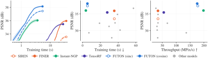{ width="960" }
  <figcaption>PSNR against training time for FUTON and the strongest model of each family, the band one within-image standard error; every model's final PSNR against its training time; and against its inference throughput.</figcaption>
</figure>

<figure markdown="span">
  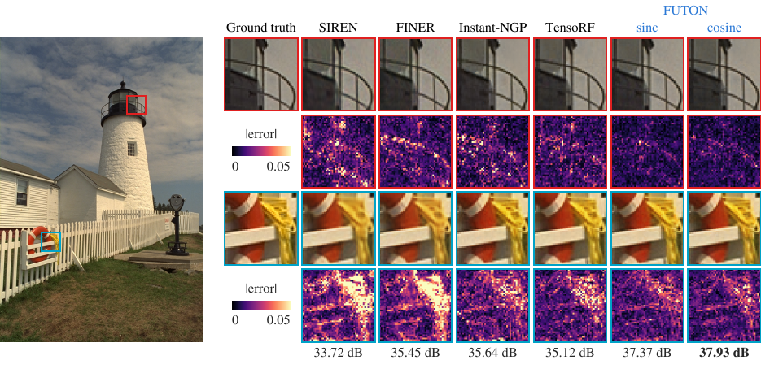
  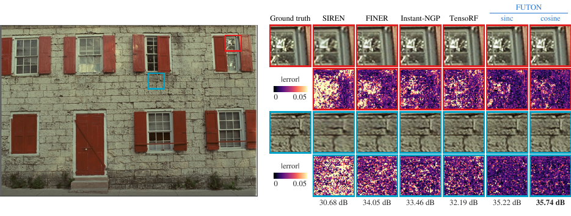
  <figcaption>kodim19 and kodim01: two regions of fine detail magnified for the ground truth and every featured model, above each model's |error| there on one scale per figure, with each model's PSNR over the whole image.</figcaption>
</figure>

## Occupancy

Five Stanford shapes voxelized at 256 samples per unit length and cropped to their bounds (2.1 to 7.9 million voxels, the longest side 231), about 131k parameters per model, 1000 steps, each on $2^{18}$ random voxels, scored by IoU on every voxel.

| Model | #Params (k) | Training time (s) ↓ | Training memory (GB) ↓ | Inference throughput (MVox/s) ↑ | Inference memory (MB) ↓ | IoU (%) Armadillo ↑ | IoU (%) Dragon ↑ | IoU (%) Happy Buddha ↑ | IoU (%) Lucy ↑ | IoU (%) Thai Statue ↑ | IoU (%) Mean ↑ |
| --- | --- | --- | --- | --- | --- | --- | --- | --- | --- | --- | --- |
| RFF | 132.2 | 11.7 | 1.04 | 48.2 | 819 | **99.97** | 99.97 | 99.91 | 99.79 | **99.93** | 99.91 ± 0.03 |
| PE-MLP | 132.3 | 15.4 | 1.02 | 48.2 | 520 | 98.30 | 98.27 | 98.86 | 95.46 | 98.01 | 97.78 ± 0.60 |
| MFN | 138.0 | 27.4 | 3.77 | 38.3 | 1359 | 99.47 | 98.52 | 98.49 | 98.98 | 99.27 | 98.95 ± 0.20 |
| SIREN | 132.9 | 17.1 | 1.62 | 50.6 | 551 | 99.02 | 99.60 | 99.85 | 99.45 | 99.09 | 99.40 ± 0.16 |
| FreSh (SIREN) | 132.9 | 41.6 | 1.62 | 50.4 | 551 | 99.54 | 99.83 | **99.97** | 99.75 | 99.56 | 99.73 ± 0.08 |
| Gauss | 132.9 | 17.5 | 1.62 | 50.8 | 551 | 99.69 | 99.95 | 99.94 | 99.87 | 99.72 | 99.83 ± 0.05 |
| WIRE | 133.4 | 21.9 | 1.91 | 46.6 | 583 | 99.78 | 99.96 | **99.97** | 99.93 | 99.88 | 99.90 ± 0.03 |
| FINER | 132.9 | 17.2 | 1.62 | 50.5 | 551 | 99.43 | 99.81 | **99.97** | 99.87 | 99.54 | 99.73 ± 0.10 |
| Instant-NGP | 133.2 | **2.6** | _0.53_ | _158.0_ | 718 | 99.96 | 99.96 | 99.78 | 99.80 | 99.78 | 99.86 ± 0.04 |
| TensoRF | 132.4 | 6.4 | **0.44** | **191.1** | **282** | 99.86 | 99.77 | 99.74 | 99.50 | 99.50 | 99.67 ± 0.07 |
| GA-Planes | 132.0 | 17.8 | 0.58 | 105.8 | _328_ | 99.88 | 99.95 | 99.94 | 99.90 | 99.85 | 99.90 ± 0.02 |
| F-INR (SIREN) | 131.8 | _5.9_ | 1.65 | 119.9 | 835 | 98.05 | 98.53 | 98.74 | 97.42 | 97.73 | 98.09 ± 0.24 |
| FUTON (sinc) | 130.6 | 7.8 | _0.53_ | 123.3 | 526 | **99.97** | **99.98** | 99.96 | **99.95** | 99.90 | **99.95** ± 0.01 |
| FUTON (cosine) | 130.6 | 7.6 | _0.53_ | 122.0 | 527 | **99.97** | **99.98** | 99.95 | **99.95** | _99.92_ | **99.95** ± 0.01 |

<figure markdown="span">
  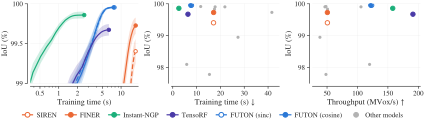{ width="960" }
  <figcaption>IoU against training time for the featured models; every model's final IoU against its training time; and against its inference throughput, in megavoxels per second.</figcaption>
</figure>

<figure markdown="span">
  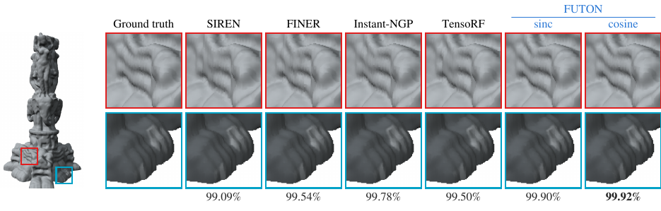
  <figcaption>The Thai statue, reconstructed from each model's checkpoint by marching cubes and rendered offscreen.</figcaption>
</figure>

## Radiance fields

Eight NeRF synthetic (Blender) scenes under FINER's protocol: 200 × 200 views, 25 training views, 25,000 steps of 4096 rays (FINER's protocol trains for 37,500), scored on all 200 test views. Every model is the density network of the same radiance field (15 geometry features, spherical-harmonics direction encoding, a 64 × 2 colour MLP), about 75k parameters in all.

| Model | #Params (k) | Training time (s) ↓ | Training memory (GB) ↓ | Inference FPS ↑ | Inference memory (MB) ↓ | PSNR (dB) ↑ | SSIM ↑ | LPIPS ↓ |
| --- | --- | --- | --- | --- | --- | --- | --- | --- |
| RFF | 74.5 | 179.3 | 2.91 | **7.0** | 67 | 28.07 ± 0.30 | 0.928 ± 0.004 | 0.082 ± 0.008 |
| PE-MLP | 75.1 | 201.0 | 3.00 | 6.6 | 68 | 27.94 ± 0.21 | 0.931 ± 0.002 | 0.079 ± 0.006 |
| MFN | 75.8 | 275.6 | 9.97 | 6.6 | 134 | 28.28 ± 0.17 | 0.932 ± 0.002 | 0.078 ± 0.006 |
| SIREN | 75.2 | 215.5 | 5.08 | 6.3 | 64 | 28.53 ± 0.17 | 0.935 ± 0.002 | 0.106 ± 0.008 |
| FreSh (SIREN) | 75.2 | 217.2 | 5.03 | 6.0 | 61 | 28.34 ± 0.23 | 0.928 ± 0.004 | 0.146 ± 0.016 |
| Gauss | 75.2 | 239.1 | 4.82 | 6.4 | 72 | 27.54 ± 0.22 | 0.922 ± 0.003 | 0.105 ± 0.008 |
| WIRE | 74.5 | 237.9 | 4.97 | 6.1 | 69 | 28.29 ± 0.20 | 0.928 ± 0.003 | 0.126 ± 0.007 |
| FINER | 75.2 | 218.8 | 5.02 | 6.1 | 64 | 28.62 ± 0.19 | 0.934 ± 0.002 | 0.120 ± 0.010 |
| Instant-NGP | 75.0 | **147.0** | 2.80 | 6.8 | 114 | 26.60 ± 0.37 | 0.908 ± 0.009 | 0.119 ± 0.011 |
| TensoRF | 74.8 | 246.2 | 2.14 | _6.9_ | _50_ | 27.99 ± 0.18 | 0.931 ± 0.003 | 0.076 ± 0.006 |
| GA-Planes | 75.0 | 271.6 | 2.10 | 6.7 | _50_ | 28.24 ± 0.18 | 0.936 ± 0.003 | 0.071 ± 0.005 |
| F-INR (SIREN) | 74.7 | 292.8 | 16.18 | 6.0 | 296 | 27.52 ± 0.46 | 0.911 ± 0.012 | 0.127 ± 0.020 |
| FUTON (sinc) | 73.0 | 153.7 | **1.88** | 6.6 | _50_ | _29.19_ ± 0.22 | **0.943** ± 0.003 | **0.065** ± 0.006 |
| FUTON (cosine) | 73.0 | _152.0_ | **1.88** | 6.6 | **49** | **29.22** ± 0.22 | **0.943** ± 0.004 | **0.065** ± 0.007 |

Per scene, FUTON leads six of the eight: ficus, hotdog and lego with the sinc basis, materials and ship with the cosine one, and chair with both, 0.002 dB apart; FINER leads drums and mic.

| Model | Chair | Drums | Ficus | Hotdog | Lego | Materials | Mic | Ship |
| --- | --- | --- | --- | --- | --- | --- | --- | --- |
| RFF | 33.10 | 22.91 | 27.47 | 32.76 | 28.48 | 25.62 | 33.37 | 20.88 |
| PE-MLP | 32.09 | 22.84 | 25.75 | 32.06 | 28.55 | 26.64 | 32.44 | 23.12 |
| MFN | 32.94 | 23.77 | 27.28 | 32.56 | 28.52 | 25.60 | 33.04 | 22.50 |
| SIREN | 32.54 | _24.58_ | 27.61 | 32.40 | 29.03 | 26.53 | 33.25 | 22.29 |
| FreSh (SIREN) | 32.38 | 24.19 | 27.60 | 32.81 | 29.62 | 25.18 | 32.58 | 22.32 |
| Gauss | 30.92 | 23.69 | 26.41 | 32.07 | 27.66 | 25.21 | 32.46 | 21.94 |
| WIRE | 32.63 | 24.18 | 27.54 | 32.00 | 28.44 | 26.14 | 33.23 | 22.13 |
| FINER | 32.85 | **24.61** | _27.74_ | 32.30 | 29.46 | 26.11 | **33.58** | 22.27 |
| Instant-NGP | 31.35 | 23.03 | 22.64 | 30.87 | 27.29 | 24.57 | 31.92 | 21.16 |
| TensoRF | 31.60 | 23.70 | 25.74 | 32.73 | 28.60 | 26.31 | 32.43 | 22.78 |
| GA-Planes | 32.58 | 23.75 | 25.77 | 33.06 | 29.63 | 26.09 | 32.29 | 22.79 |
| F-INR (SIREN) | 32.81 | 21.42 | 24.23 | 32.39 | 29.22 | 27.37 | 31.78 | 20.93 |
| FUTON (sinc) | **33.18** | 23.95 | **27.75** | **33.27** | **31.34** | _27.50_ | 33.28 | _23.27_ |
| FUTON (cosine) | **33.18** | 23.86 | 27.70 | _33.20_ | _31.28_ | **27.65** | _33.40_ | **23.48** |

Test-view PSNR in dB. `results/nerf/table.md` also lists SSIM and LPIPS per scene.

<figure markdown="span">
  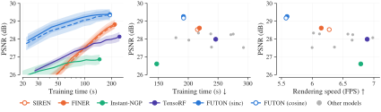{ width="960" }
  <figcaption>Validation PSNR against training time for the featured models; every model's final test PSNR against its training time; and against its rendering speed, in frames per second.</figcaption>
</figure>

<figure markdown="span">
  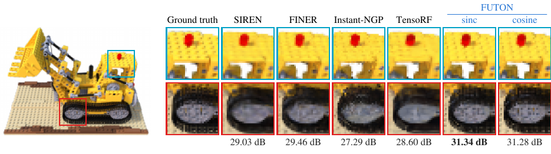
  <figcaption>The lego scene from a test view, with two regions magnified.</figcaption>
</figure>

<figure markdown="span">
  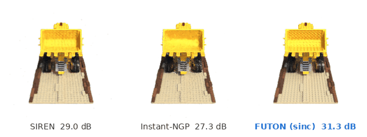{ width="720" }
  <figcaption>The same scene in orbit: SIREN, Instant-NGP and FUTON (sinc), with their test-view PSNR.</figcaption>
</figure>

## Super-resolution

The 100 DIV2K validation images, observed at a quarter of their size. Each image, about 2040 × 1356 pixels, is downsampled 4× with the antialiased bicubic filter of MATLAB's `imresize`, the standard protocol, and the models see nothing but the result, about 510 × 339 pixels. A field maps the high-resolution coordinates to RGB and is trained through the downsampling operator: a step draws 135 blocks of 8 × 8 low-resolution pixels, as many on every image, and evaluates the field at the high-resolution pixels beneath them (261,360 evaluations, about $2^{18}$), downsamples the result with the same filter and takes the L1 distance to the observed pixels, for 1000 steps at about 500k parameters per model. The deep image prior (DIP) trains its convolutional generator through the same operator and joins nearest, bilinear and bicubic interpolation as a reference row. FUTON's grid of components is the low-resolution size, K = (H/4, W/4), its decoder 128 wide, and its rank the largest multiple of 5 within the budget on each image (510 on 0882), since the grid follows the image's size where the baselines' widths do not. Every model's scale and learning rate, and FUTON's components and width, were chosen on three DIV2K training images (0395, 0431 and 0777) by the mean gain over bicubic, with the L1 loss throughout. PSNR and SSIM are computed on the luma channel after shaving a 4-pixel border, LPIPS on RGB, all against the original image.

| Model | #Params (k) | Training time (s) ↓ | Training memory (GB) ↓ | Inference throughput (MPix/s) ↑ | Inference memory (GB) ↓ | PSNR (dB) ↑ | SSIM ↑ | LPIPS ↓ |
| --- | --- | --- | --- | --- | --- | --- | --- | --- |
| Nearest | – | – | – | – | – | 26.73 ± 0.05 | 0.734 ± 0.001 | 0.459 ± 0.005 |
| Bilinear | – | – | – | – | – | 27.53 ± 0.05 | 0.757 ± 0.002 | _0.368_ ± 0.003 |
| Bicubic | – | – | – | – | – | 28.10 ± 0.06 | 0.775 ± 0.002 | **0.353** ± 0.003 |
| DIP | 505.3 | 95.6 | 8.79 | _124.3_ | 2.75 | 27.31 ± 0.06 | 0.735 ± 0.002 | 0.446 ± 0.004 |
| RFF | 500.0 | 52.1 | 2.46 | 14.0 | 0.97 | 26.05 ± 0.08 | 0.703 ± 0.002 | 0.496 ± 0.003 |
| PE-MLP | 502.1 | 59.8 | 2.56 | 14.4 | 0.87 | 20.62 ± 0.25 | 0.573 ± 0.006 | 0.613 ± 0.005 |
| MFN | 501.8 | 81.4 | 8.03 | 12.2 | 3.42 | 27.10 ± 0.09 | 0.735 ± 0.002 | 0.454 ± 0.002 |
| SIREN | 500.6 | 61.7 | 3.83 | 14.8 | 0.88 | 27.97 ± 0.07 | 0.763 ± 0.002 | 0.407 ± 0.002 |
| FreSh (SIREN) | 500.6 | 65.6 | 3.83 | 14.7 | 0.88 | 27.64 ± 0.07 | 0.756 ± 0.002 | 0.418 ± 0.002 |
| Gauss | 500.6 | 64.8 | 4.26 | 14.8 | 0.88 | 24.71 ± 0.10 | 0.584 ± 0.005 | 0.557 ± 0.006 |
| WIRE | 502.0 | 56.9 | 4.22 | 14.7 | 0.93 | 24.99 ± 0.09 | 0.670 ± 0.003 | 0.546 ± 0.003 |
| FINER | 500.6 | 61.6 | 3.83 | 14.7 | 0.88 | 28.12 ± 0.07 | 0.751 ± 0.001 | 0.424 ± 0.003 |
| Instant-NGP | 505.2 | **2.9** | **0.43** | **187.6** | **0.31** | _28.22_ ± 0.08 | 0.763 ± 0.002 | 0.394 ± 0.002 |
| TensoRF | 500.4 | 40.5 | 2.37 | 29.7 | 0.89 | 27.54 ± 0.05 | 0.750 ± 0.002 | 0.418 ± 0.002 |
| GA-Planes | 501.3 | 29.7 | 3.22 | 38.0 | _0.65_ | 27.93 ± 0.06 | 0.756 ± 0.001 | 0.416 ± 0.002 |
| F-INR (SIREN) | 501.8 | _6.3_ | 2.84 | 104.2 | 1.45 | 23.13 ± 0.18 | 0.627 ± 0.005 | 0.589 ± 0.003 |
| FUTON (sinc) | 498.8 | 9.3 | _0.83_ | 78.9 | 0.70 | **28.59** ± 0.10 | **0.784** ± 0.003 | 0.382 ± 0.002 |
| FUTON (cosine) | 498.8 | 9.2 | _0.83_ | 78.9 | 0.70 | 28.21 ± 0.20 | _0.778_ ± 0.004 | 0.390 ± 0.002 |

<figure markdown="span">
  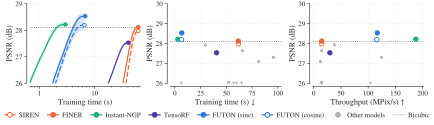{ width="960" }
  <figcaption>PSNR against training time for FUTON and the strongest model of each family, with bicubic interpolation as the dotted level; every model's final PSNR against its training time, the four below 26 dB as markers on the axis line; and against its inference throughput, in megapixels per second.</figcaption>
</figure>

<figure markdown="span">
  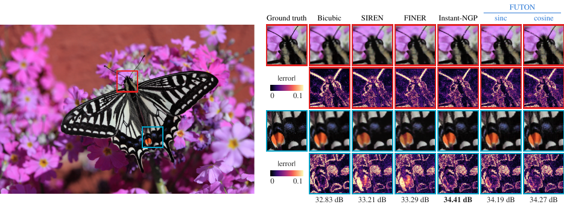
  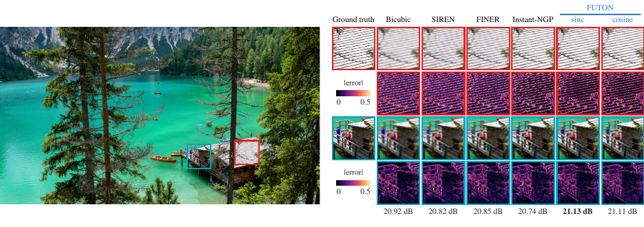
  <figcaption>DIV2K 0882 and 0807: the butterfly's head and a hindwing, and the two regions of the lakeside where the models disagree most, magnified for the original, bicubic interpolation and the featured fields, above each model's |error| on one scale per figure, with each model's PSNR over the whole image. Bicubic stands in for TensoRF here, the weakest featured model on this task, so that the reference every model is measured against is in view.</figcaption>
</figure>

Super-resolution is the hardest task here for every model: nothing but the low-resolution image is seen, so the margins are fractions of a decibel and most fields lose to bicubic interpolation. FUTON (sinc) beats bicubic on 97 of the 100 images, by 0.49 dB on average and 1.36 dB on 0882, and leads PSNR and SSIM. Instant-NGP, the fastest model to train here at 2.9 s, gains 0.12 dB on average but beats bicubic on only 53 images, and FINER, 0.02 dB, on 42. FUTON (cosine) beats bicubic on 89 images, but on four its output falls 2 to 17 dB below it, which brings its mean down to 28.21 dB, the hash grid's level: it fits the observed pixels there as closely as anywhere, yet carries artifacts at high resolution that the downsampling does not show, on 0843 21.4 dB against bicubic's 38.8. The sinc basis fails so on one image, 0852, by 4.7 dB. The deep image prior and TensoRF do not beat bicubic on average, and F-INR (SIREN), the second fastest to train at 6.3 s, ends below it on every image, by 5.0 dB on average. The deep image prior is still rising slowly when its 1000 steps end, so its paper's margin over bicubic needs a budget the protocol does not give it. Bicubic keeps the best LPIPS, by 0.030 over FUTON (sinc), which suggests the fields buy their PSNR at edges rather than in texture, the one thing a single low-resolution image cannot teach. PE-MLP is the one model the protocol does not serve: the tuning images chose a rate of 3e-4 for it, at which it ends 7.5 dB below bicubic on average and below 20 dB on 44 of the 100 images.

## Reading the numbers

- **Accuracy.** FUTON leads PSNR, SSIM and LPIPS on images, the cosine basis by 1.42 dB over MFN, the strongest baseline, and the sinc basis by 0.72 dB, ahead of every baseline on 22 and 20 of the 24 images. On volumes it has the best mean IoU, 99.95 % against 99.91 % for RFF, the best IoU on three of the five shapes, and it passes 99.8 % on every shape after 4.3 s of training, where GA-Planes, the only other model to get there, takes 11.4 s. On radiance fields it leads FINER by 0.60 dB (cosine) and 0.58 dB (sinc) and six of the eight scenes, and on super-resolution FUTON (sinc) leads Instant-NGP by 0.37 dB and every other model on 86 of the 100 images.
- **Speed.** Instant-NGP is the fastest model to train on every task: 3.6 s against FUTON's 5.4 s on images, 2.6 s against 7.6 s on volumes, 147 s against 152 s on radiance fields and 2.9 s against 9.2 s on super-resolution. FUTON follows it on images and radiance fields, and on the other two tasks a few models train faster at a lower accuracy: F-INR (SIREN) and TensoRF on volumes and F-INR (SIREN) on super-resolution. FUTON's training memory is the lowest on images and radiance fields, 0.67 and 1.88 GB, and close to the lowest on volumes and super-resolution, 0.53 and 0.83 GB. The hash grid is a PyTorch port of tiny-cuda-nn's, without the fused CUDA kernels, gathering every level in one batched pass; FUTON is plain PyTorch, and every model is compiled.
- **At inference** Instant-NGP is again the fastest on images (198 against FUTON's 178 megapixels per second) and on super-resolution (188 against 79), and TensoRF on volumes (191 megavoxels per second, Instant-NGP 158, FUTON 123). A radiance field renders a view in 140 to 170 ms whatever its density network, 6.0 to 7.0 frames per second, since the ray marcher feeds it batches too small to fill the GPU. FUTON renders at 6.6, 0.4 below RFF, a gap close to the 0.3 by which its two bases, which do the same work, differ at one size in the components study, and in the least memory, 49 and 50 MB against 50 MB for TensoRF and GA-Planes.
- **The two bases** cost the same to train and to evaluate. The cosine basis is the better one on images, by 0.70 dB, the two tie on volumes and on radiance fields, 0.03 dB apart, and the sinc basis is ahead in super-resolution, by 0.38 dB, where the cosine basis fails on four images.

## Checks against the literature

Where the protocol meets a published one, the numbers agree, allowing for the shorter radiance-field schedule. The super-resolution pipeline reads DIV2K's own low-resolution images, which the forward operator reproduces from the originals to 57 dB, and its bicubic baseline is 26.66 dB in the EDSR and LIIF convention (RGB, a 10-pixel shave), the published value; the 28.10 dB above is the same baseline on luma with a 4-pixel shave. The radiance-field protocol is FINER's, which trains for 37,500 steps; at our 25,000 and our 75k budget, SIREN lands 0.3 dB and FINER 0.6 dB below that paper's table on average, by at most 1.1 dB on a scene, and our PE-MLP and WIRE are stronger than its. The deep image prior's margin over bicubic, a decibel at 4× in its paper, needs more steps than the protocol gives it, as noted above. The hash grid's low radiance-field score is what a 75k budget leaves it: its tables hold 2^11 entries per level, 256 times fewer than in its paper.

The [ablations](ablations.md) take FUTON apart, and [Reproducing the paper](reproduce.md) has the commands that produced every number above.
