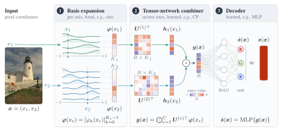

---
hide:
  - navigation
  - toc
---

# NeuroField

**Neural fields in PyTorch.** A signal is fitted as a function of its coordinates: NeuroField provides FUTON, the Fourier Tensor Network of the paper, thirteen baselines behind the same interface, coordinate datasets for images, volumes and posed views, and the training loops and scripts that produce the paper's numbers.

<figure markdown="span">
  { width="960" }
  <figcaption>FUTON's forward pass for one pixel: a fixed basis expands each coordinate, a low-rank tensor network combines the axes, and a small MLP decodes the pixel's colour.</figcaption>
</figure>

```python
import torch
import neurofield as nf

model = nf.FUTON(
    in_features=2,
    out_features=3,
    basis=("sinc", {"num_components": [384, 256]}),  # half of a 768 x 512 image per axis
    combiner=("cp", {"rank": 280}),
    decoder=("mlp", {"hidden_layers": 1, "hidden_features": 64}),
    output_activation=torch.tanh,
)
rgb = model(torch.rand(4096, 2) * 2 - 1)  # coordinates in [-1, 1]^2 -> (4096, 3)
```

<div class="grid cards" markdown>

-   :material-rocket-launch:{ .lg .middle } **Getting started**

    ---

    Install the package, fit an image in a dozen lines, and read what the training loop returns.

    [:octicons-arrow-right-24: Installation](getting-started/installation.md) · [Quick start](getting-started/quickstart.md)

-   :material-book-open-variant:{ .lg .middle } **Concepts**

    ---

    How a neural field, a dataset and the training loop fit together, and how FUTON is built from a basis, a combiner and a decoder.

    [:octicons-arrow-right-24: Neural fields](concepts/neural-fields.md) · [FUTON](concepts/futon.md)

-   :material-school:{ .lg .middle } **Tutorials**

    ---

    Images, occupancy volumes, radiance fields, image compression, and writing your own components.

    [:octicons-arrow-right-24: Tutorials](tutorials/index.md)

-   :material-chart-line:{ .lg .middle } **Experiments**

    ---

    The benchmark protocol, every table and figure of the paper, the ablations, and how to reproduce them from the configs.

    [:octicons-arrow-right-24: Benchmarks](experiments/benchmarks.md) · [Reproduce](experiments/reproduce.md)

-   :material-code-braces:{ .lg .middle } **API reference**

    ---

    Every public class and function, with tensor shapes, defaults and the paper's equations.

    [:octicons-arrow-right-24: API](api/index.md)

-   :material-lifebuoy:{ .lg .middle } **Troubleshooting**

    ---

    Coordinate ranges, memory, backends, and the other things that go wrong first.

    [:octicons-arrow-right-24: Troubleshooting](troubleshooting.md)

</div>

## Why FUTON

Most implicit neural representations hide their prior in the nonlinearity: sines, Gabor wavelets, Gaussians, or a hash-grid lookup in front of a ReLU network. FUTON puts the prior in the parameterization. The signal is expanded in a fixed, analytic basis along each coordinate axis, and the coefficient tensor of that expansion is kept in low-rank canonical polyadic (CP) form. The model is then a shallow, parallel tensor contraction rather than a deep network:

- **Fast.** One point costs $O(CKR)$ for $C$ axes, $K$ basis functions per axis and rank $R$. A compactly supported basis such as Lanczos touches only $2a$ taps per axis. On a grid, such as an image's pixels, each axis is evaluated once per distinct coordinate and shared by every point on it. It is all plain PyTorch, and `torch.compile` fuses the gathers with the products.
- **Accurate at equal size.** At matched parameter counts FUTON leads every baseline on the average of each benchmark: Kodak images, Stanford occupancy volumes, Blender radiance fields and DIV2K super-resolution.
- **Transparent.** With a linear decoder, FUTON *is* a rank-$R$ CP model of the signal in the chosen basis, so bandwidth ($K$) and capacity ($R$) are explicit knobs with a meaning.

## Results at a glance

Every model of a task has the same parameter budget, the hyperparameters of its authors' code, and a learning rate chosen on the task. Times are median training times per signal on an A100, from the same runs as the scores, every model compiled with `torch.compile`; Instant-NGP is the fastest to train on every task. See [Benchmarks](experiments/benchmarks.md) for every model, metric and error bar.

| Task | Signals | #Params | FUTON (sinc) | FUTON (cosine) | Strongest baseline |
| --- | --- | --- | --- | --- | --- |
| Images (Kodak) | 24 | 197k | 37.44 dB in 5.4 s | **38.14 dB** in 5.4 s | MFN, 36.72 dB in 57.3 s |
| Occupancy (Stanford) | 5 | 131k | **99.95 % IoU** in 7.8 s | **99.95 % IoU** in 7.6 s | RFF, 99.91 % in 11.7 s |
| Radiance fields (Blender) | 8 | 74k | 29.19 dB in 154 s | **29.22 dB** in 152 s | FINER, 28.62 dB in 219 s |
| Super-resolution (DIV2K, 4×) | 100 | 500k | **28.59 dB** in 9.3 s | 28.21 dB in 9.2 s | Instant-NGP, 28.22 dB in 2.9 s |

<figure markdown="span">
  { width="960" }
  <figcaption>Kodak: PSNR against training time for FUTON and the strongest model of each family (the band is one within-image standard error); every model's final PSNR against its training time; and against its inference throughput.</figcaption>
</figure>

<figure markdown="span">
  
  <figcaption>kodim19 at about 197k parameters. The two boxed regions are magnified for the ground truth and every featured model, above each model's |error|; the PSNR is over the whole image.</figcaption>
</figure>

## Citation

If you use NeuroField or FUTON in your research, please cite the paper:

```bibtex
@article{ashtari2026futon,
  title   = {{FUTON}: Fourier Tensor Network for Implicit Neural Representations},
  author  = {Ashtari, Pooya and Behmandpoor, Pourya and Deligiannis, Nikos and Pi{\v{z}}urica, Aleksandra},
  journal = {arXiv preprint arXiv:2602.13414},
  year    = {2026}
}
```

The code is released under the [MIT license](https://github.com/pashtari/neurofield/blob/main/LICENSE).
